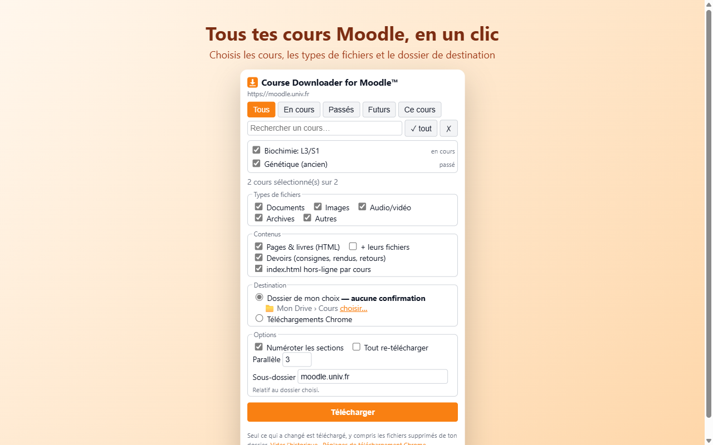

# Course Downloader for Moodle™

Extension Chrome / Edge / Brave qui télécharge et **synchronise** les fichiers de tes cours Moodle dans le
dossier de ton choix — y compris un dossier Google Drive pour ordinateur.
Fonctionne avec **n'importe quel Moodle** (SSO/CAS compris). Aucune donnée collectée, aucun serveur.



## Fonctions
- **Tous les Moodle** : détection automatique du site (y compris installé en sous-dossier) ;
  l'extension n'accède qu'à l'onglet sur lequel tu cliques.
- **Sélection des cours** : recherche, filtres En cours / Passés / Futurs, bouton « Ce cours », date de dernière synchro.
- **Contenus** : fichiers, dossiers (avec sous-dossiers), fichiers intégrés, pages & livres en HTML,
  devoirs (consignes, pièces jointes, rendu, retours), vraies URL des liens, format « une section par page ».
- **Sync incrémentale** : seul ce qui a changé est téléchargé (révision Moodle, ETag, empreinte des pages) ;
  fichier supprimé ou déplacé → repris ; journal `_nouveautes.html`.
- **index.html hors-ligne** par cours.
- **Destination** :
  - *Dossier de mon choix* (défaut) : écriture directe, **jamais de fenêtre « Enregistrer sous »** ;
    la synchro tourne dans un onglet dédié à laisser ouvert.
  - *Téléchargements Chrome* : via le gestionnaire de téléchargements (désactiver « Demander où enregistrer »).
- **Contrôle** : pause / reprise / annulation, réessai des échecs, 1–8 transferts parallèles, filtres par type,
  badge de progression, notification de fin, mode sombre.

## Installation
**Chrome Web Store** : *(lien à venir)*

**Depuis les sources** :
1. Télécharger ce dépôt (Code → Download ZIP) et le décompresser.
2. `chrome://extensions` → activer *Mode développeur* → *Charger l'extension non empaquetée* → dossier `extension/`.

## Utilisation
1. Se connecter à son Moodle, rester sur une page du site.
2. Cliquer sur l'icône → choisir les cours → **Télécharger**.
3. Première fois : accepter l'accès au site, choisir le dossier (un sous-dossier, ex. `Mon Drive\Cours`),
   autoriser la modification. Ensuite un clic suffit.

## Développement
```
extension/        code de l'extension (Manifest V3, sans dépendance)
  engine.js       moteur commun : file, historique, journal
  background.js   mode Téléchargements Chrome
  sync.html/.js   mode Dossier (File System Access)
  content.js      lecture du Moodle (injecté à la demande)
  popup.html/.js  interface
test/             faux Moodle + tests bout en bout (Playwright)
scripts/build.js  paquet Chrome Web Store → dist/
store/            fiche store + captures
moodle_scraper.py alternative en ligne de commande (Python)
```

Tests (81 vérifications : UI, fichiers sur disque, sync incrémentale, pause/annulation/réessai, mode dossier) :

    cd test && npm install && npm test

Paquet pour le store (retire les crochets de test) :

    node scripts/build.js

### Script Python (alternative)
    pip install -r requirements.txt
    python moodle_scraper.py https://moodle.exemple.fr --cookie <MoodleSession>

## Avertissement
Usage personnel : l'extension ne télécharge que ce à quoi tu as déjà accès. Les supports de cours restent
la propriété de leurs auteurs — ne les redistribue pas.

Moodle™ est une marque déposée de Moodle Pty Ltd. Projet indépendant, non affilié à Moodle Pty Ltd ni approuvé par elle.

## Licence
[MIT](LICENSE) — [Politique de confidentialité](PRIVACY.md)
